# ChoresRewards

A self-hosted family hub for chores, rewards, meals, shopping, and the household calendar.

Kids complete chores, earn points (or pocket money), and redeem rewards. Parents get a single place for the weekly meal plan, shopping list, family events, sticky notes, and car/bill reminders. Built for a tablet on the fridge, a browser, or an Unraid box.

**GitHub:** [matda59/ChoresRewards](https://github.com/matda59/ChoresRewards)  
**Docker:** `ghcr.io/matda59/choresrewards:latest`  
**Unraid support:** [forum thread](https://forums.unraid.net/topic/192603-choresrewards-support-thread/)

---

## Screenshots

### Today at a Glance
Tasks left, meals, upcoming events, top rewards, family photos, and sticky notes — plus live clock and weather in the header.

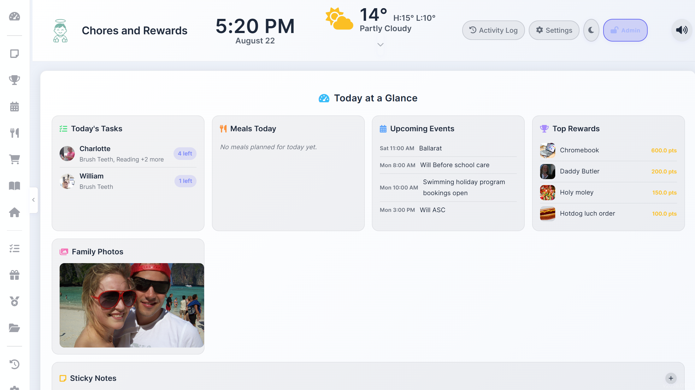

### Rewards
Custom rewards with photos, point costs, and progress toward redeeming.

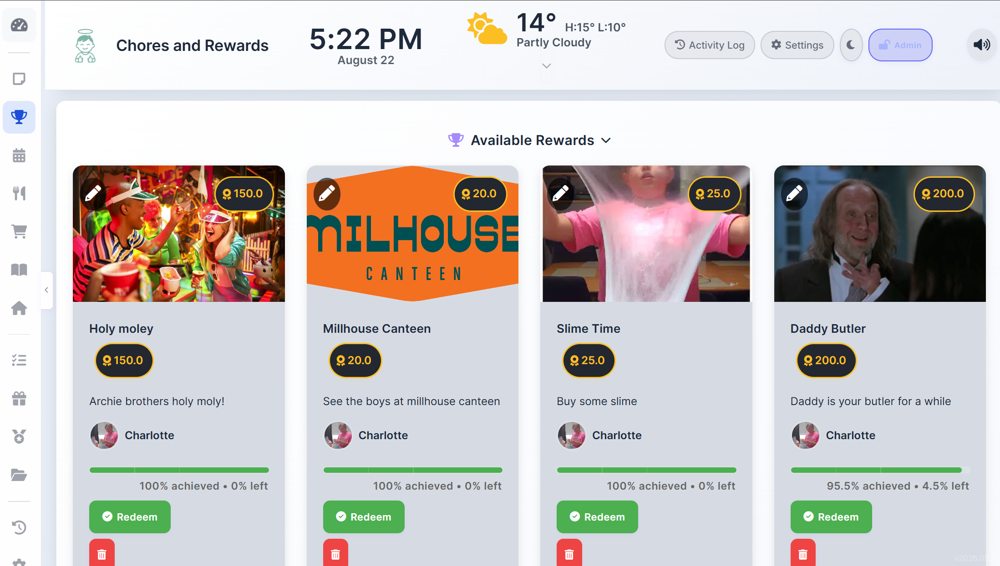

### Family calendar
Google Calendar week view with colour-coded events and a time grid.

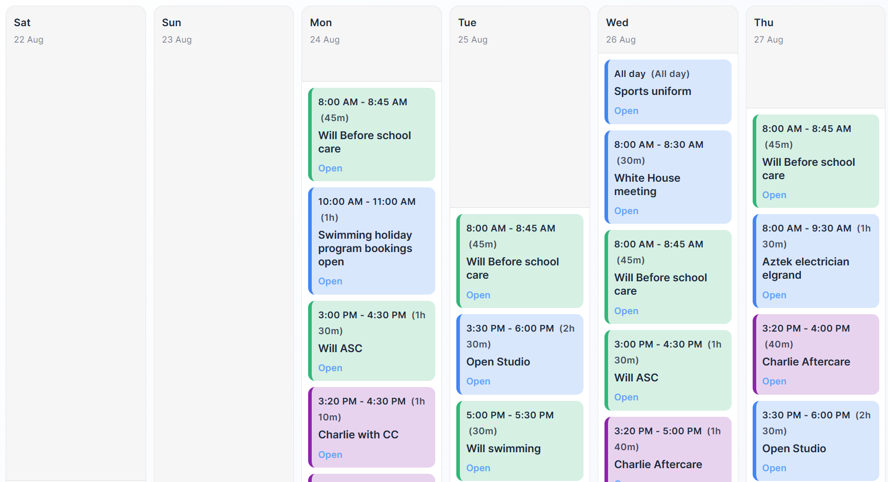

### Weekly meal planner
Plan breakfast, lunch, and dinner. Drag meals to swap. Click to edit.

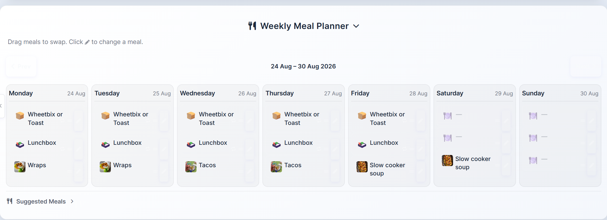

### Shopping list
Ingredients from this week's meals plus general shopping, split by store.

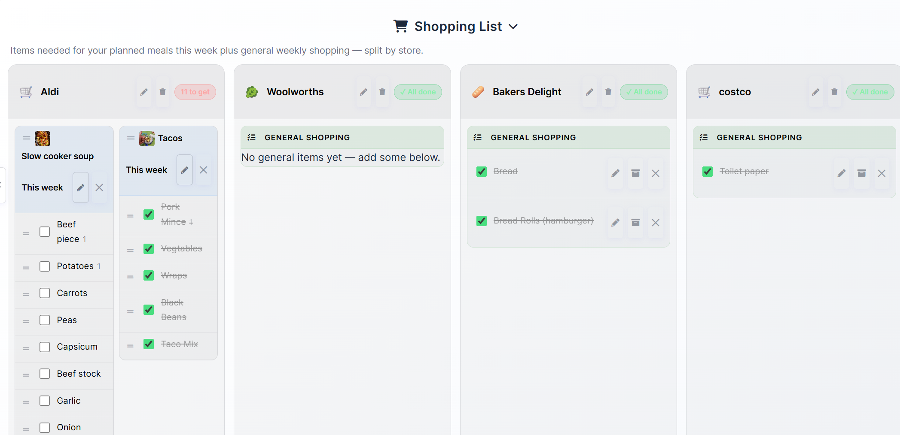

### Meal library
Save meals with ingredients, quantities, and which store they come from.

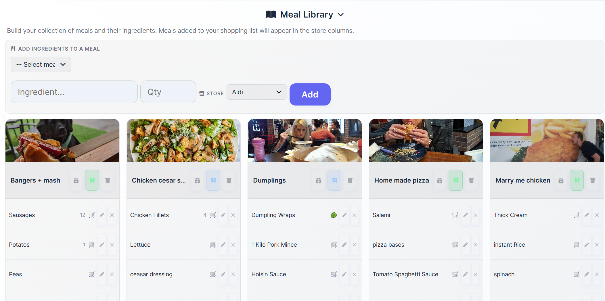

### Family chores
Per-child kanban columns with points, streaks, badges, emoji icons, and Complete buttons.

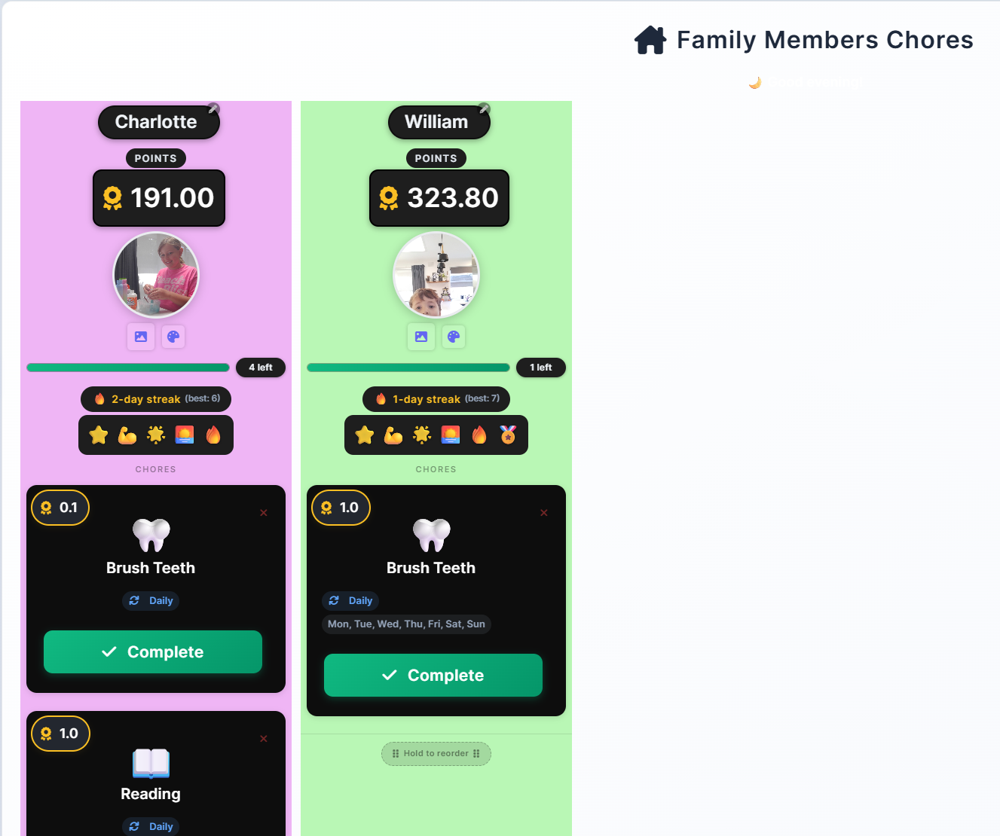

### Organise
Cars, insurance, bills, and service history with due dates and mileage.

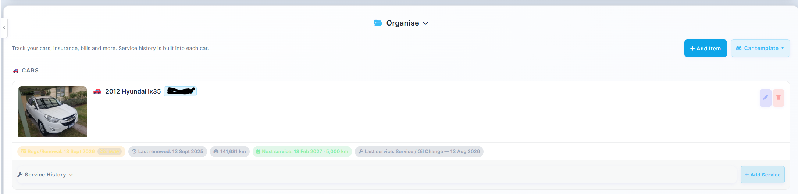

### Sticky notes
Colour-coded, resizable notes on the dashboard.

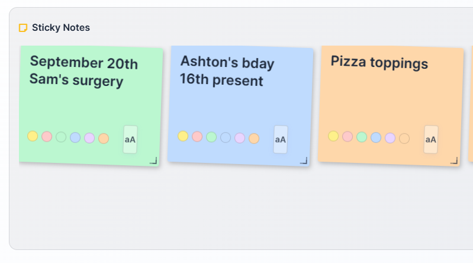

### Settings
Points or cash, family members, bonus points, custom sounds, Gotify, quizzes, and a photo screensaver.

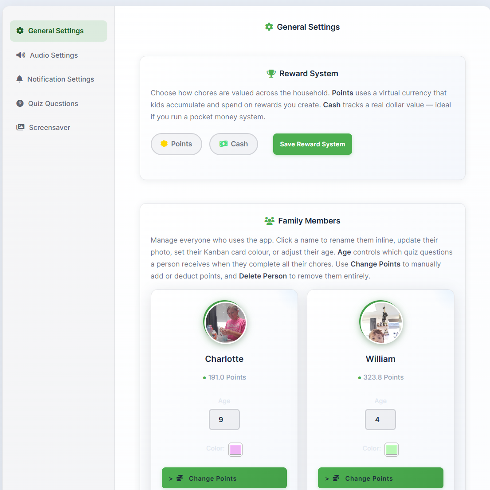
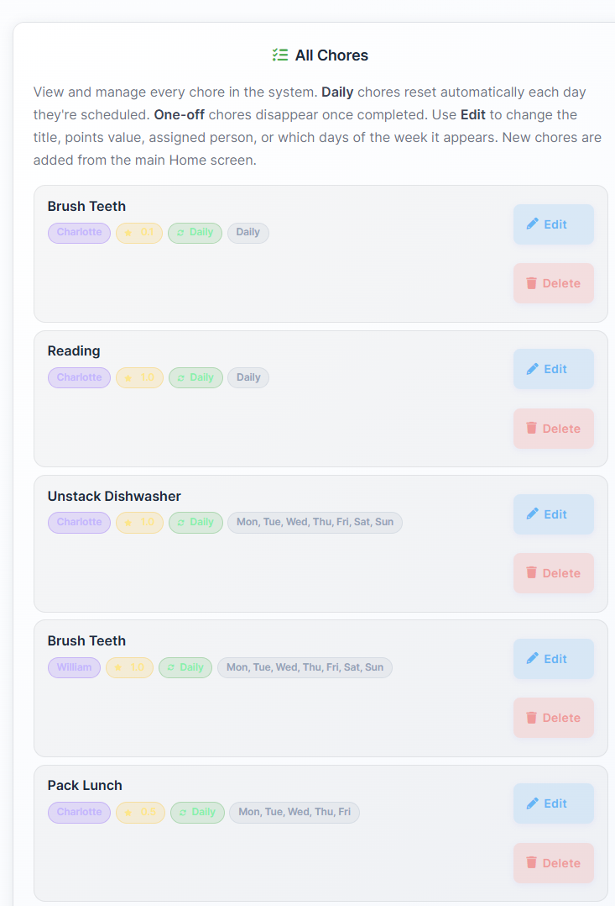
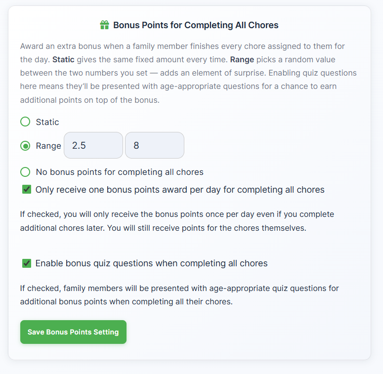
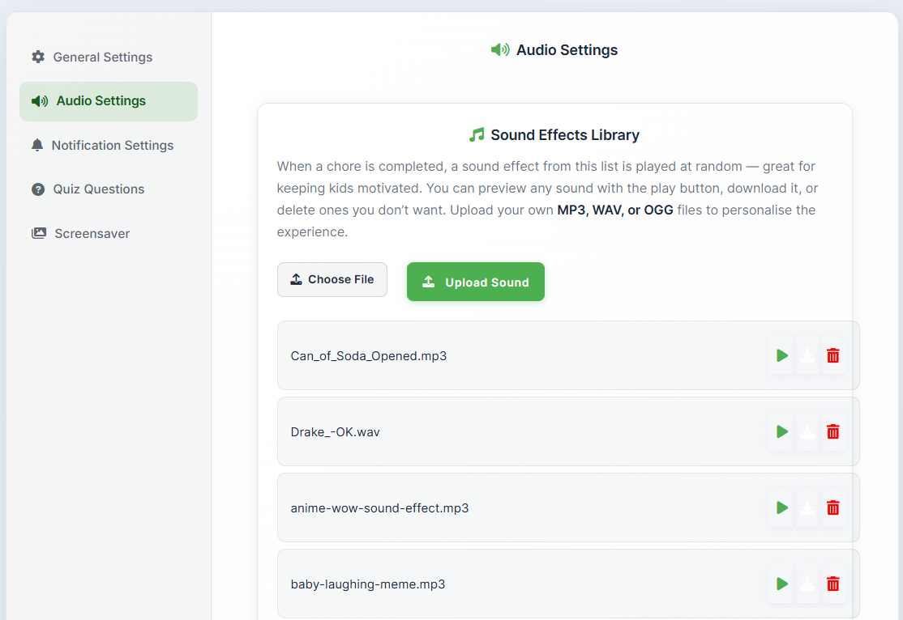
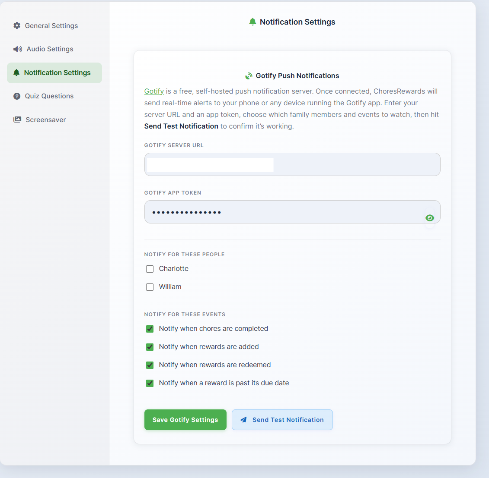
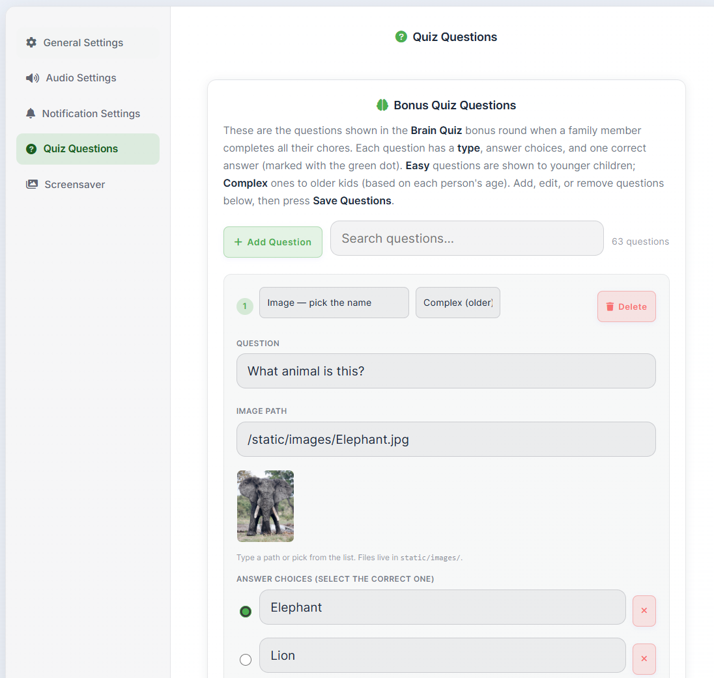
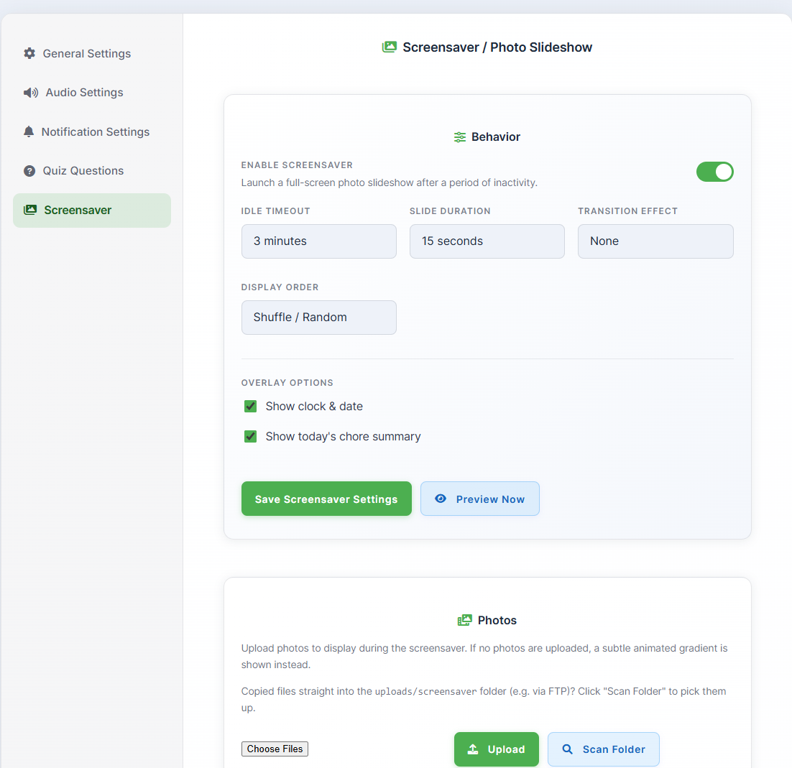

---

## Features

### Chores & rewards
- Per-person chore columns with custom colours, avatars, and emoji icons
- Daily chores that reset automatically, or one-off chores that disappear when done
- Schedule chores for specific days of the week
- Decimal point values (e.g. 0.1 for brushing teeth)
- Drag and drop to reorder chores
- Points **or** cash / pocket-money mode
- Bonus points when all chores are done — fixed amount, or a random range
- Optional age-appropriate Brain Quiz for extra bonus points
- Custom sound effects on chore complete (upload MP3, WAV, or OGG)
- Celebrations when a kid finishes everything
- Streaks and badges (first chore, 10/50/100 chores, perfect day, early bird, 3/7/30-day streaks)
- 4-digit master PIN so kids can't change settings

### Household
- **Dashboard** — today's leftover chores, meals, events, rewards, and family photos
- **Weather** — current conditions plus a 7-day forecast in the sticky header
- **Google Calendar** — family week view with colour rules, time-grid or list
- **Meal planner** — weekly plan with suggested meals and drag-to-swap
- **Shopping list** — meal ingredients + general items, grouped by store (Aldi, Woolworths, etc.)
- **Meal library** — recipes/ingredients you reuse each week
- **Sticky notes** — resizable, colour-coded, with a text-size toggle
- **Organise** — cars, rego, insurance, bills, and per-car service history
- **Screensaver** — full-screen family photo slideshow after idle, with clock and today's chore summary
- **Gotify** — self-hosted push notifications for chore complete, reward added/redeemed, overdue rewards
- **Activity log** — history of what happened and who did it
- Dark and light themes

### Family-friendly
- First-run setup wizard
- Admin lock on the sidebar
- Age field drives quiz difficulty (easy vs complex)
- Tuned for an always-on tablet / low-end hardware

---

## Quick start (Docker)

```bash
docker run -d \
  --name choresrewards \
  -p 3112:3000 \
  -e TZ=Australia/Adelaide \
  -e ENABLE_GOOGLE_CALENDAR=true \
  -v choresrewards_data:/app/instance \
  -v choresrewards_uploads:/app/static/uploads \
  --restart unless-stopped \
  ghcr.io/matda59/choresrewards:latest
```

Open `http://localhost:3112` and complete the setup wizard.

### Session secret

The PIN is enforced by the server. Sessions are signed with `CR_SECRET_KEY` or `SECRET_KEY` when one of those is set to at least 16 characters. Otherwise the first boot writes a random key to `/app/instance/secret_key`. Set the same long random key on every container if you run more than one.

```bash
python -c "import secrets; print(secrets.token_hex(32))"
```

```yaml
environment:
  - CR_SECRET_KEY=paste-that-value
```

The session cookie is HttpOnly and SameSite=Lax. It is marked Secure when the browser is on HTTPS (`X-Forwarded-Proto: https` from Caddy or Cloudflare). `CR_COOKIE_SECURE=1` forces Secure, and `CR_COOKIE_SECURE=0` leaves it off for a plain `http://` LAN address.

If the site is reachable on the internet, put Cloudflare Access in front of it (email one-time PIN, allow-list of family emails) as a second layer. The app PIN is still the lock inside the house.

### Read-only API key

A trusted automation, such as the owner's assistant, can read family data without a browser login. Set `CR_READONLY_API_KEY` to a random string of at least 32 characters. If the variable is unset, blank, or shorter than that, the feature is off and the header is ignored.

```bash
python -c "import secrets; print(secrets.token_urlsafe(32))"
```

Put that value in the container environment, then restart so the process picks it up:

```yaml
environment:
  - CR_READONLY_API_KEY=paste-that-value
```

```bash
docker compose up -d
```

Send the key in a header. A query string is ignored.

```bash
curl -sS -H "Authorization: Bearer $CR_READONLY_API_KEY" \
  http://localhost:3112/api/notifications
```

`X-API-Key: <key>` is accepted as well. The key allows `GET` and `HEAD` only, and only on these paths:

- `/api/screensaver/chore_summary` — remaining chores per person, and the next upcoming calendar events
- `/api/meal_planner`
- `/api/shopping_list`
- `/api/shopping_stores`
- `/api/meal_ingredients`
- `/api/notifications` — dashboard alerts, including vehicle service and rego reminders
- `/api/notes`
- `/api/dashboard_notes`
- `/api/organise` — bills, vehicles, and next service dates
- `/api/organise/<id>/services` — service history for one vehicle

Anything else is refused, including `POST`, settings, uploads, and the home page. The home page is what runs the daily chore reset, so a key request cannot trigger that. The key does not create a session cookie and does not count toward the PIN lockout. Repeated wrong keys are rate-limited on their own.

When the header is present it is the only credential checked for that request. A normal browser session does not send it, so PIN login stays the same.

### Write API key

`CR_WRITE_API_KEY` is a second key for the same assistant. It can read everything the read-only key can read, and it can make the everyday changes in the table below. Generate a different value. If it is unset, blank, shorter than 32 characters, or the same string as `CR_READONLY_API_KEY`, the write key is disabled (the read-only key keeps working).

```bash
python -c "import secrets; print(secrets.token_urlsafe(32))"
```

```yaml
environment:
  - CR_READONLY_API_KEY=paste-the-read-key
  - CR_WRITE_API_KEY=paste-a-different-write-key
```

Restart the container after setting it (`docker compose up -d`, or restart the Unraid container). Send it the same way as the read-only key. A query string is ignored.

```bash
curl -sS -H "Authorization: Bearer $CR_WRITE_API_KEY" \
  -H "Content-Type: application/json" \
  -d '{"title":"Pack lunch","assigned_to":"Will","points":1}' \
  http://localhost:3112/add_chore
```

```bash
curl -sS -H "X-API-Key: $CR_WRITE_API_KEY" \
  -H "Content-Type: application/json" \
  -d '{"name":"Milk","store":"aldi"}' \
  http://localhost:3112/api/shopping_list/items
```

```bash
curl -sS -H "Authorization: Bearer $CR_WRITE_API_KEY" \
  -H "Content-Type: application/json" \
  -d '{"date":"2026-11-23","meal":"dinner","value":"Pasta"}' \
  http://localhost:3112/api/meal_planner/slot
```

The write key does not set a session cookie, does not open the home page (that page runs the daily chore reset), and does not share the PIN lockout. A wrong key for either API key counts toward the same limit: 8 failures in 5 minutes from one address, then `429`. A correct key still works during that window. Each allowed write prints one audit line to the container log (`method`, `path`, `key_type=write`, timestamp, status). The key itself is not logged.

A browser session is still checked for `Origin`. A request that presents a valid write key for an allowlisted change is not, because the key is the credential rather than the cookie.

| Method and path | What it does | JSON body |
|---|---|---|
| `POST /add_chore` | Add a one-off or repeating chore | `{"title","assigned_to","points","is_daily","due_datetime","days_of_week","icon"}`. `assigned_to` is the person's name. `days_of_week` makes it repeat. |
| `POST /edit_chore` | Edit a chore, including who it is assigned to | `{"chore_id","title","assigned_to","points","days_of_week","icon","is_daily"}` |
| `POST /add_daily_chore` | Add an every-day chore | `{"title","assigned_to","points"}` |
| `POST /edit_daily_chore` | Edit an every-day chore | `{"chore_id","title","assigned_to","points","days_of_week"}` |
| `POST /delete_chore` | Delete a one-off chore. A daily chore is skipped today unless `permanent` is true | `{"chore_id","permanent"}` |
| `POST /delete_daily_chore` | Permanently remove a daily chore | `{"chore_id"}` |
| `POST /complete_chore` | Mark a chore done and award points when it is on time | `{"chore_id"}` |
| `POST /undo_complete_chore` | Undo that completion | `{"chore_id"}` |
| `POST /api/extra_chores/claim` | Put one catalog extra chore on a person's list | `{"extra_id","person_id"}` |
| `POST /add_reward` | Add a reward. No file upload | `{"title","points_required","assigned_to","description","image_url"}` |
| `POST /edit_reward` | Edit a reward | `{"reward_id","title","description","points_required","assigned_to"}` |
| `POST /delete_reward` | Remove a reward | `{"reward_id"}` |
| `POST /complete_reward` | Redeem a reward and spend the points | `{"reward_id"}` |
| `POST /award_bonus_points` | Award the configured bonus | `{"person_id","bonus_points"}` |
| `POST /reset_points` | Set someone's points balance | `{"person_id","new_points"}` |
| `POST /api/meal_planner/slot` | Set or clear one meal on one date | `{"date":"YYYY-MM-DD","meal":"dinner","value":"Pasta"}`. `meal` is breakfast, lunch, or dinner. An empty `value` clears that slot. |
| `POST /api/meal_planner/recurring` | Set one weekday repeat | `{"weekday":"monday","meal":"dinner","value":"Pasta","enabled":true}` |
| `POST /api/meal_planner/suggestions/items` | Add one meal name to the suggestion list | `{"text":"Tacos"}` |
| `POST /api/meal_planner/suggestions/remove` | Remove one suggestion | `{"text":"Tacos"}` |
| `POST /api/meal_ingredients/items` | Add one ingredient to a meal | `{"meal":"pasta","name":"Tomatoes","store":"aldi","qty":"1 tin"}` |
| `POST /api/meal_ingredients/items/remove` | Remove that ingredient | `{"meal":"pasta","name":"Tomatoes"}` |
| `POST /api/shopping_list/items` | Add one manual shopping line | `{"name":"Milk","store":"aldi"}` |
| `POST /api/shopping_list/items/check` | Tick or untick a line | `{"name":"Milk","store":"aldi","checked":true}` or `{"key":"meal::pasta::tomatoes","checked":true}` |
| `POST /api/shopping_list/items/remove` | Remove one manual line | `{"name":"Milk","store":"aldi"}` |
| `POST /api/notes/cards` | Add a To Do / kanban card | `{"text":"Book dentist","column_id":"col-todo"}`. `column_id` is optional. |
| `POST /api/notes/cards/update` | Edit, tick, or move a card | `{"id","text","checked","column_id"}` |
| `POST /api/notes/cards/remove` | Clear a card | `{"id"}` |
| `POST /api/dashboard_notes/notes` | Add a dashboard post-it | `{"text":"Bins tonight","color":"#fef08a","text_size":"md"}` |
| `POST /api/dashboard_notes/notes/update` | Edit a post-it | `{"id","text","color","text_size"}` |
| `POST /api/dashboard_notes/notes/remove` | Remove a post-it | `{"id"}` |

The write key cannot:

- open `GET /` or anything else that runs the daily chore reset
- change settings, the master PIN, logins, or logouts
- add, delete, or rename family members
- upload files, avatars, sounds, or photos
- replace a whole shopping list, note board, dashboard, meal week, or ingredient library in one body (those page saves stay on the logged-in session, because a partial body would wipe the rest)
- create bills, vehicle service logs, or Google Calendar events (the calendar is only read into the chore summary; the app does not store its own events)

`X-API-Key` works on these calls too. The read-only key still cannot call any of them.

Map **both** volumes. Uploads (avatars, reward photos, screensaver pictures, organise photos) live under `/app/static/uploads` and will disappear on container update if that path is not persisted.

### Docker Compose

```yaml
services:
  choresawards:
    image: ghcr.io/matda59/choresrewards:latest
    ports:
      - "3112:3000"
    volumes:
      - ./instance:/app/instance
      - uploads_data:/app/static/uploads
    environment:
      - TZ=Australia/Adelaide
      - ENABLE_GOOGLE_CALENDAR=true
      # - CR_READONLY_API_KEY=paste-that-value
      # - CR_WRITE_API_KEY=paste-a-different-value
    restart: always

volumes:
  uploads_data:
```

```bash
docker compose up -d
```

### Unraid

Install from Community Applications, or use the template pointing at `ghcr.io/matda59/choresrewards:latest`.

| Path / port | Container | Purpose |
|---|---|---|
| appdata folder | `/app/instance` | SQLite database |
| uploads folder | `/app/static/uploads` | Photos and custom sounds |
| `3112` | `3000` | Web UI |
| `TZ` | | Your timezone |
| `ENABLE_GOOGLE_CALENDAR` | `true` | Show Google Calendar settings |

---

## Local nightly channel

Test new features (Google Calendar, screensaver, etc.) without touching a stable `latest` deploy.

```powershell
docker compose -f docker-compose.nightly.yml up --build -d
```

- Nightly URL: `http://localhost:3113`
- Data volume: `nightly_instance_data`
- Uploads volume: `nightly_uploads_data`

Stop:

```powershell
docker compose -f docker-compose.nightly.yml down
```

Rebuild after code changes:

```powershell
docker compose -f docker-compose.nightly.yml up --build -d
```

This is local-only. It does not push to GitHub or GHCR.

---

## Optional: Google Calendar

1. Set `ENABLE_GOOGLE_CALENDAR=true`
2. In Settings, enable Google Calendar
3. Add Calendar ID(s)
4. Upload a Google service-account JSON key
5. Share each calendar with the service-account email

Colour rules let you tint events (e.g. Will vs Charlie vs household).

---

## Optional: Gotify

In **Settings → Notification Settings**, add your Gotify server URL and app token. Choose which family members and events to notify on, then send a test notification.

---

## Tech

- Python / Flask / SQLite
- Gunicorn in Docker
- Image: `ghcr.io/matda59/choresrewards:latest` (and `:nightly`)
- Port **3000** in the container

No cloud account required. Family data stays on your server. Optional Google Calendar and weather lookups call those services. Anonymous install counting is described below.

---

## Usage statistics

Image pulls and installs are counted separately.

- **Pulls** are GHCR downloads. Updates count again, so this number is larger than the number of households. A daily job stores the history in `stats/usage.json`.
- **Installs** count each saved data folder once, the first time a container starts.
- **Check-ins** happen at most once a day per install.

The container only downloads two tiny public files on GitHub. That increments download counters. Names, chores, photos, and your server address are not sent.

Adults can open **Usage statistics** from the sidebar chart icon, or from Settings. To turn counting off, set `CHORESREWARDS_TELEMETRY=off`, or clear the checkbox on that page.

GitHub stars, forks, and 14-day clone and view totals are on the same page.
